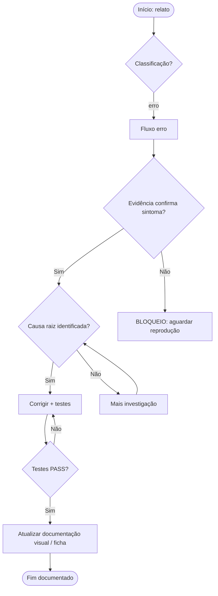

# Exemplo fictício — erro em tela de listagem (ilustrativo)

> **Marcador:** `(exemplo fictício)` — não descreve ITEM real nem ambiente de produção.

## Resumo em 30 segundos

Um usuário reporta que a listagem não carrega após filtrar por data. O time confirma o sintoma no DEV, investiga evidência, corrige com testes e valida antes de considerar a entrega documentada neste fluxo pedagógico.

## Mapa visual (trecho)

**Sequência em texto:** relato → classificar como erro → buscar evidência → se não confirmar, bloquear → identificar causa → corrigir → testes; se falhar, voltar à correção → documentar estado.

## Etapa E3 (fictícia) — Evidência

- **Por que existe:** evitar correção no escuro.
- **Entrada:** relato, ambiente, trace_id se houver.
- **Saída:** veredito `confirmado` ou `não verificado` com próximo passo.
- **Fonte neste exemplo:** hipotética; em trabalho real, citar a skill `investigar-erro` ou evidência da ficha.

Use este arquivo só como referência de forma; substitua todas as etapas por fatos e fontes reais no documento final.
